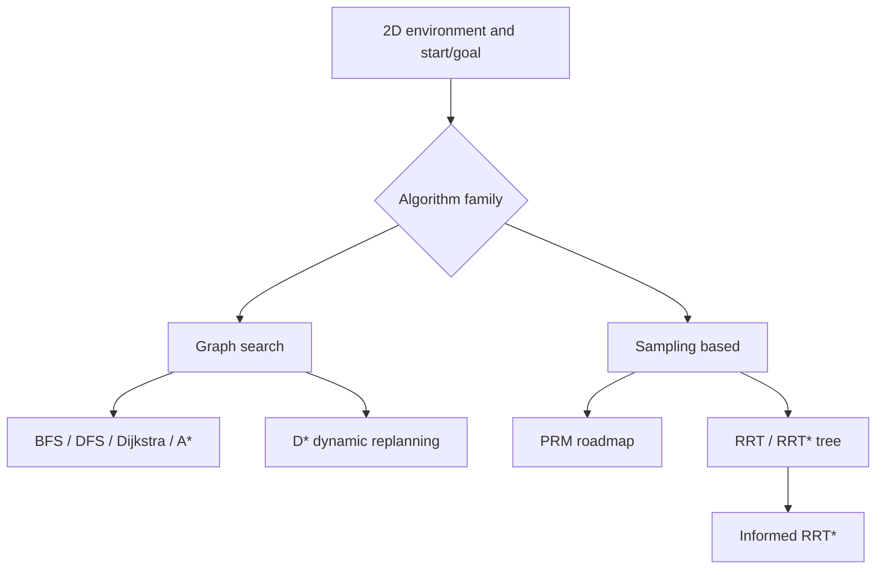

# Motion Planning — Graph Search, PRM, RRT*, D* and Informed RRT*

Implementations of classical 2D mobile-robot motion-planning algorithms, from grid search to randomized sampling and dynamic-map replanning. The work is organized into five independent programming projects.

## Algorithm comparison

| Module | Algorithms | Principle | Code | Report |
| --- | --- | --- | --- | --- |
| 1 | BFS, DFS | Uninformed graph search on a discrete grid | [Search](Project%201/search.py) | [PDF](Project%201/BFS_DFS_Algorithm%20Implementation%20Report%20(1).pdf) |
| 2 | Dijkstra, A* | Lowest-cost graph search vs heuristic search | [Search](Project%202/search.py) | [PDF](Project%202/Dijkstra_A_star.pdf) |
| 3 | PRM | Sample collision-free configurations to construct a roadmap | [PRM](Project%203/PRM.py) | [PDF](Project%203/PRM_Report.pdf) |
| 4 | RRT, RRT* | Expand a sampling tree; rewire to improve path cost | [RRT](Project%204/RRT.py) | [PDF](Project%204/RRT_Report.pdf) |
| 5 | D*, Informed RRT* | Adapt paths to modified maps; focus samples after a solution | [D*](Project%205/D_star/search.py), [Informed RRT*](Project%205/informed_RRT/RRT.py) | [PDF](Project%205/Advanced%20Search%20Algorithms%20Report.pdf) |

The table compares algorithmic mechanisms.

## Gallery — saved algorithm visualizations

| Uniform PRM sampling | Gaussian PRM sampling |
| --- | --- |
|  |  |

| Random PRM sampling | Bridge PRM sampling |
| --- | --- |
|  |  |

| RRT | RRT* |
| --- | --- |
|  |  |

## Planning families



## Running

Run each independent project from its own folder, where its relative map and module paths resolve:

```bash
cd "Project 4"
python main.py
```

Projects 1–4 each have `main.py`; Project 5 has separate `D_star/main.py` and `informed_RRT/main.py` runners. Dependencies vary among NumPy, Matplotlib, Pillow and SciPy.
